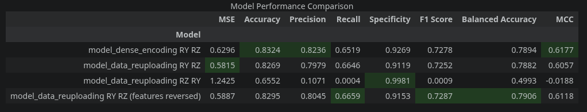

# Hipoteza

Model na znormalizowanych danych przez min-max będzie działał lepiej gdy użyjemy **dense angle encoding**, niż gdy użyjemy zwykłego angle encoding i po pierwszej warstwie będziemy wstrzykiwać więcej features (**feature reuploading**)

# Modele

```
model_dense_encoding RY RZ
     ┌──────────┐┌──────────┐┌──────────┐          ┌──────────┐          ┌──────────┐
q_0: ┤ Ry(x[0]) ├┤ Rz(x[3]) ├┤ Ry(t[0]) ├──■────■──┤ Ry(t[3]) ├──■────■──┤ Ry(t[6]) ├
     ├──────────┤├──────────┤├──────────┤┌─┴─┐  │  ├──────────┤┌─┴─┐  │  ├──────────┤
q_1: ┤ Ry(x[1]) ├┤ Rz(x[4]) ├┤ Ry(t[1]) ├┤ X ├──┼──┤ Ry(t[4]) ├┤ X ├──┼──┤ Ry(t[7]) ├
     ├──────────┤├──────────┤├──────────┤└───┘┌─┴─┐├──────────┤└───┘┌─┴─┐├──────────┤
q_2: ┤ Ry(x[2]) ├┤ Rz(x[5]) ├┤ Ry(t[2]) ├─────┤ X ├┤ Ry(t[5]) ├─────┤ X ├┤ Ry(t[8]) ├
     └──────────┘└──────────┘└──────────┘     └───┘└──────────┘     └───┘└──────────┘ 

model_data_reuploading RY RZ
     ┌──────────┐┌──────────┐┌──────────┐          ┌──────────┐          ┌──────────┐
q_0: ┤ Ry(x[0]) ├┤ Ry(t[0]) ├┤ Rz(x[3]) ├──■────■──┤ Ry(t[3]) ├──■────■──┤ Ry(t[6]) ├
     ├──────────┤├──────────┤├──────────┤┌─┴─┐  │  ├──────────┤┌─┴─┐  │  ├──────────┤
q_1: ┤ Ry(x[1]) ├┤ Ry(t[1]) ├┤ Rz(x[4]) ├┤ X ├──┼──┤ Ry(t[4]) ├┤ X ├──┼──┤ Ry(t[7]) ├
     ├──────────┤├──────────┤├──────────┤└───┘┌─┴─┐├──────────┤└───┘┌─┴─┐├──────────┤
q_2: ┤ Ry(x[2]) ├┤ Ry(t[2]) ├┤ Rz(x[5]) ├─────┤ X ├┤ Ry(t[5]) ├─────┤ X ├┤ Ry(t[8]) ├
     └──────────┘└──────────┘└──────────┘     └───┘└──────────┘     └───┘└──────────┘ 

model_data_reuploading RZ RY
     ┌──────────┐┌──────────┐┌──────────┐          ┌──────────┐          ┌──────────┐
q_0: ┤ Rz(x[0]) ├┤ Ry(t[0]) ├┤ Ry(x[3]) ├──■────■──┤ Ry(t[3]) ├──■────■──┤ Ry(t[6]) ├
     ├──────────┤├──────────┤├──────────┤┌─┴─┐  │  ├──────────┤┌─┴─┐  │  ├──────────┤
q_1: ┤ Rz(x[1]) ├┤ Ry(t[1]) ├┤ Ry(x[4]) ├┤ X ├──┼──┤ Ry(t[4]) ├┤ X ├──┼──┤ Ry(t[7]) ├
     ├──────────┤├──────────┤├──────────┤└───┘┌─┴─┐├──────────┤└───┘┌─┴─┐├──────────┤
q_2: ┤ Rz(x[2]) ├┤ Ry(t[2]) ├┤ Ry(x[5]) ├─────┤ X ├┤ Ry(t[5]) ├─────┤ X ├┤ Ry(t[8]) ├
     └──────────┘└──────────┘└──────────┘     └───┘└──────────┘     └───┘└──────────┘ 

model_data_reuploading RY RZ (features reversed)
     ┌──────────┐┌──────────┐┌──────────┐          ┌──────────┐          ┌──────────┐
q_0: ┤ Ry(x[3]) ├┤ Ry(t[0]) ├┤ Rz(x[0]) ├──■────■──┤ Ry(t[3]) ├──■────■──┤ Ry(t[6]) ├
     ├──────────┤├──────────┤├──────────┤┌─┴─┐  │  ├──────────┤┌─┴─┐  │  ├──────────┤
q_1: ┤ Ry(x[4]) ├┤ Ry(t[1]) ├┤ Rz(x[1]) ├┤ X ├──┼──┤ Ry(t[4]) ├┤ X ├──┼──┤ Ry(t[7]) ├
     ├──────────┤├──────────┤├──────────┤└───┘┌─┴─┐├──────────┤└───┘┌─┴─┐├──────────┤
q_2: ┤ Ry(x[5]) ├┤ Ry(t[2]) ├┤ Rz(x[2]) ├─────┤ X ├┤ Ry(t[5]) ├─────┤ X ├┤ Ry(t[8]) ├
     └──────────┘└──────────┘└──────────┘     └───┘└──────────┘     └───┘└──────────┘ 
```

# Wyniki




